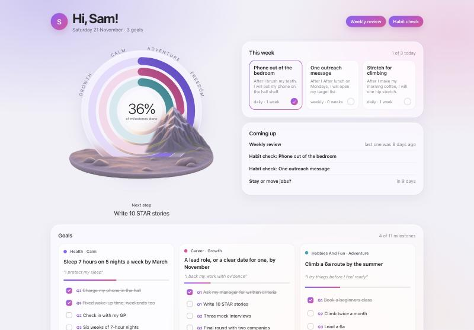

# Life Compass

An evidence-based reflection, goal and habit coach that runs inside **your own AI**.

Life Compass guides you from reflection to 1–3 goals to tiny daily habits, then keeps you going with short reviews. It's grounded in behavioural science: values work (ACT), goal setting, WOOP, implementation intentions, tiny habits, COM-B, habit-strength tracking and kind lapse handling.

It's an [MCP](https://modelcontextprotocol.io) server: you add it to an AI app you already use, and your AI becomes the coach. **Your plan is a file on your computer. Nothing is sent anywhere else.**

## What you need

- [Node.js](https://nodejs.org) 18 or newer
- An AI app that supports MCP, for example Claude Desktop, Claude Code, Cursor, or LM Studio (for local models)

## Install

```bash
git clone https://github.com/naya85/life-compass.git
cd life-compass
npm install
```

Then add it to your AI app. Replace `/path/to/life-compass` with where you cloned it.

**Claude Desktop**: Settings → Developer → Edit Config, then add:

```json
{
  "mcpServers": {
    "life-compass": { "command": "node", "args": ["/path/to/life-compass/src/index.js"] }
  }
}
```

**Claude Code**:

```bash
claude mcp add life-compass -- node /path/to/life-compass/src/index.js
```

**Cursor, LM Studio and other MCP apps**: add a server with command `node` and argument `/path/to/life-compass/src/index.js`.

Restart the app.

## Use it

Start a chat and say **"Start my Life Compass"** (or pick the `life_compass` prompt if your app shows prompts). Your AI will:

1. **Reflect** with you, one question at a time (about 15 minutes)
2. Help you **choose** 1 to 3 goals tied to your values
3. **Plan** milestones and tiny habits with cues and if-then plans
4. Help you **act**: say "I did my walk" and it logs it
5. Run short **reviews**: "weekly review", "monthly check", "quarterly review"

Want calendar reminders? Say "export my reminders" and import the `.ics` file it creates.

## The dashboard

A visual Compass for your plan: rings for each goal, a mountain that grows with your progress, one-tap habit tiles, what's coming up, goals with milestones, and wins.

```bash
npm run ui
```

Or ask your AI to "open my dashboard". It runs on your computer only, at a private link with a random key; other websites can't read or change your plan. Changes you make there and through your AI show up in both.



## Where your data lives

`~/.life-compass/plan.json` (change it with the `LIFE_COMPASS_DIR` environment variable). It's plain JSON you can read, back up or delete. A one-step backup is kept as `plan.json.bak`.

## What's inside

| File | What it is |
| --- | --- |
| `src/method.js` | The method: rules, questions and steps, each with the reason it's there |
| `src/coach.js` | Phase, what's due, capacity limits, habit strength (SRBAI), lapses |
| `src/store.js` | Local plan file, written safely |
| `src/index.js` | The MCP server: 21 tools, the `life_compass` prompt, and the method and plan as resources |
| `src/web.js`, `src/web/` | The local dashboard and its small, key-protected API |
| `test/` | End-to-end and dashboard security tests (`npm test`) |

## Not therapy

Life Compass is a self-coaching tool. If you're in crisis or struggling with your mental health, please reach out to a professional or your local emergency number.

## License

MIT
